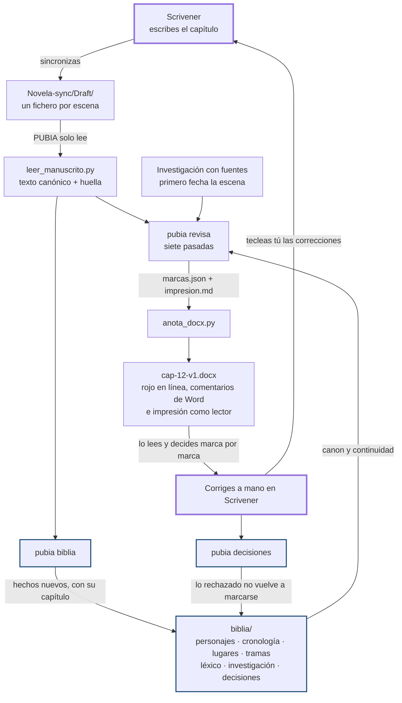

# PUBIA

[](https://github.com/grananda/pubia/actions/workflows/validate.yml)
[](LICENSE)

Marketplace de Claude Code para **corregir novela escrita en Scrivener sin que nadie
toque el manuscrito**.

El autor escribe en Scrivener. PUBIA lee el capítulo, lo cruza con la memoria de la
novela y devuelve un `.docx` de sugerencias.

**Principio rector: no escribir por el autor.** Tres niveles, de más a menos
imperativo:

- **Rojo**, en línea: solo lo crucial y objetivo —ortografía, gramática,
  concordancia de género y número, rayas y puntuación de diálogo, formas verbales,
  fuga de tratamiento, grafía de un nombre ya establecido—.
- **Azul**, como **comentarios reales de Word al margen** y con umbral alto: lo que
  obliga a detenerse —continuidad, inexactitud histórica o médica **comprobada**,
  ambigüedad real, lógica narrativa, cambio involuntario de caracterización—.
- **Violeta**, sugerencias **opcionales** que el autor toma o deja: cacofonías,
  repeticiones muy cercanas, redacción que obliga a releer, ritmo, la palabra que
  sonaría mejor.

Lo que hace la voz del autor —oralidad, dialecto, léxico regional e inventado, la
imagen deliberada— no se marca en ningún color. El documento cierra con una sección de **impresión como lector**, que no
forma parte de la corrección.

Las correcciones las teclea el autor en Scrivener. PUBIA no escribe nunca en el
manuscrito.

---

## El ciclo



Trazo grueso, lo que haces tú. En azul, el bucle de memoria: es lo que permite revisar
el capítulo 31 contra lo que estableció el 4. **La única flecha que entra en Scrivener
sale de tus manos**, y eso es estructural: no hay otra vía de escritura hacia el
manuscrito.

Y de vez en cuando, antes de enseñar el borrador a alguien:

```
pubia continuidad    ->  auditoría de toda la novela: cronología, quién sabe qué,
                         cabos sueltos, derivas de nombres, anacronismos
```

## Las skills

| Skill | Comando | Qué hace |
|---|---|---|
| `pubia-setup` | `pubia setup` | Prepara la carpeta de la novela, escribe `pubia.json` y explica cómo activar la sincronización con carpeta externa de Scrivener. |
| `pubia-biblia` | `pubia biblia` | Construye y mantiene `biblia/`: la memoria de la novela (personajes, cronología, lugares, tramas, léxico, decisiones). Incremental por huella de cada documento. |
| `pubia-revisa` | `pubia revisa cap 12` | El corrector. Siete pasadas (variedad y tratamiento, ortografía, gramática, continuidad, historia investigada con fuentes, narrativa, diagnóstico de estilo), un `.docx` de sugerencias y la impresión como lector. |
| `pubia-continuidad` | `pubia continuidad` | Auditoría transversal de la obra completa. Informe en Markdown, priorizado, con citas. |
| `pubia-decisiones` | `pubia decisiones cap 12` | Cierra el ciclo: registra lo que el autor rechazó para no volver a marcarlo. |

## Instalación

```
/plugin marketplace add grananda/pubia
/plugin install pubia@pubia
```

O desde una copia local del repo:

```
/plugin marketplace add ~/Git/pubia
/plugin install pubia@pubia
```

Requisitos: `uv` en el PATH. Los scripts declaran sus propias dependencias
(`python-docx`, `striprtf`) y las resuelven al ejecutarse; no se instala nada global.

## El diagrama detallado

Arriba está el ciclo en Mermaid, que GitHub dibuja solo. `docs/ciclo-pubia.html` va más
allá: el ciclo completo de
una revisión, la regla del rojo, el azul y el violeta, y por qué la época es una propiedad de la
escena y no de la novela, con las tres figuras en SVG. Es un fichero autónomo: se abre en
el navegador sin servidor.

## Primeros pasos con una novela

```
cd ~/novelas/Almenara          # la carpeta de trabajo de la novela, no este repo
pubia setup                    # pregunta la ruta de sincronización y crea la estructura
pubia biblia                   # lee lo que ya está escrito y construye la memoria
pubia revisa cap 12            # primera revisión
```

Estructura que queda en la carpeta de la novela:

```
pubia.json                      configuración (ruta de sync, época, convenciones)
biblia/                         la memoria: Markdown, versionable, editable a mano
  00-indice.md  personajes.md  cronologia.md  lugares.md
  tramas.md     lexico-y-estilo.md  investigacion.md
  decisiones.md contradicciones.md
revisiones/
  cap-12/
    cap-12.fuente.json          texto canónico extraído del manuscrito
    cap-12-v1.marcas.json       lo que se marca y por qué
    cap-12-v1.impresion.md      la impresión como lector (va dentro del .docx)
    cap-12-v1.docx              el entregable
    cap-12-v1.resueltas.json    marcas ancladas y numeradas (lo lee pubia-decisiones)
    cap-12-v1.resumen.md        la tabla de marcas en texto
```

## Garantías

- **Nunca sobrescribe.** PUBIA solo escribe en `biblia/` y `revisiones/`. La carpeta
  de sincronización de Scrivener y el manuscrito son de solo lectura, y la
  sincronización de Scrivener nunca re-importa nada de PUBIA.
- **El cuerpo del `.docx` es el manuscrito literal.** Se construye a partir del texto
  extraído, no de texto reescrito por el modelo: la revisión no puede alterar la prosa
  ni por accidente.
- **Rojo solo para el error objetivo y crucial.** Lo que obliga a detenerse va en azul
  con su motivo, y solo si cruza el umbral; lo opcional, en violeta, sin insistir. La voz del autor, el dialecto, la oralidad, el léxico
  regional e inventado y el lenguaje duro que es caracterización histórica no son
  faltas y no se comentan.
- **Respeta la variedad del español.** `variedad` en `pubia.json` y las reglas de
  `biblia/lexico-y-estilo.md` mandan: el corrector caza la fuga de *vosotros* donde la
  novela pide *ustedes*, y nunca normaliza hacia el castellano peninsular.
- **Investiga antes de afirmar un anacronismo**, cita la fuente y distingue comprobado,
  incertidumbre real, plausible no demostrable y licencia narrativa.
- **La época es de la escena, no de la novela.** `epocas` en `pubia.json` es una lista:
  una novela puede cruzar varios períodos, y cada hallazgo de `biblia/investigacion.md`
  se guarda con su **vigencia**, los años para los que vale. Si una escena no se puede
  fechar, el corrector pregunta en vez de afirmar. Lo verificado puede compartirse entre
  novelas de la misma época con `investigacion_compartida`.
- **Lo rechazado no vuelve.** `biblia/decisiones.md` es una entrada obligatoria del
  corrector.

## Cómo funciona por dentro

Dos scripts deterministas, para que el modelo decida *qué* marcar y no *cómo* pintarlo:

- `leer_manuscrito.py` — lee `.rtf` (Scrivener), `.txt` y `.md`, de un fichero o de la
  carpeta de sincronización completa (respeta el orden del binder, ignora `Notes/` y
  `Trash/`), y emite un JSON de párrafos numerados con su huella SHA-256.
  `--filtro 7` elige el documento por su número del binder (no el 17 ni el 70) y
  `--config pubia.json` toma de ahí la carpeta de sincronización (`scrivener_sync`, la
  fuente estándar, con su `Draft/`) y `modo_parrafos`.
- `anota_docx.py` — recibe ese JSON y el JSON de marcas y construye el `.docx` con
  comentarios OOXML reales (`w:commentRangeStart` / `w:comments`), correcciones en rojo
  tachado más propuesta en negrita, sugerencias en violeta con subrayado punteado y la
  propuesta opcional entre corchetes, portada con recuento por categoría, tabla resumen y
  la sección final de impresión como lector. Es estricto: si un anclaje no resuelve,
  dos correcciones se solapan o una marca usa una categoría que no es de su nivel (criterio
  o preferencia en rojo, algo opcional en azul, una categoría inventada en cualquiera), no escribe
  nada y dice cuál falla. Opciones:
  `--comentarios margen|inline|ambos` (el modo `inline` reproduce el formato
  `COMENTARIO #n — sobre «frase exacta»: explicación` en cursiva dentro del cuerpo, azul o
  violeta según el nivel) y `--tipografia` / `--cuerpo`, por defecto Times New Roman 11.

El formato de las marcas está documentado en
`plugins/pubia/skills/pubia-revisa/references/formato-marcas.md`, y los criterios de
corrección en `references/criterios-correccion.md`.

## Versiones y releases

Mismo sistema que [`aidd-marketplace`](https://github.com/grananda/aidd-marketplace), para
que los dos repos se publiquen igual.

El marketplace tiene una **versión global** en el fichero `VERSION` de la raíz. No
sustituye a la versión de `plugins/pubia/.claude-plugin/plugin.json` —esa es la que marca
qué reinstala el usuario— ni a la `metadata.version` de cada `SKILL.md`: agrupa un
conjunto de cambios en algo publicable.

**Para publicar**: sube `VERSION` en la misma PR que cambia lo que sea. Al mergear a
`main`, `release.yml` comprueba si existe la etiqueta `v<VERSION>` y, si no existe, valida,
crea la etiqueta y publica el release. La puerta es la etiqueta y no la rama, así que el
workflow es idempotente: puedes mergear varias PR sin tocar `VERSION` y no pasa nada, y
re-ejecutarlo no duplica releases.

Las notas las genera `release_notes.py` comparando contra la etiqueta anterior, en orden
de lo que más urge leer: **Atención al actualizar** (versiones mayores y commits marcados
con `!`), **Novedades** (entradas de `ROADMAP.md` que pasan a implementada), las tablas de
**qué plugins y qué skills cambian de versión**, los **skills que ya no están donde
estaban** y, plegados, los commits. Quien instala quiere saber dos cosas —si algo se rompe
y si tiene que reinstalar—, y ambas van antes que el detalle.

**Olvidarse de subir una versión** es el fallo evidente de tenerlas manuales, así que
`validate.yml` lo comprueba **en los dos sentidos** en cada PR:

| Sentido | Qué pasa si falta |
|---|---|
| `plugin.json` sube pero `VERSION` no | El release saldría sin reflejar el cambio, o no saldría |
| Hay ficheros del plugin modificados y la misma versión | El silencioso: Claude Code cree que la copia instalada está al día, así que el cambio **nunca llega al usuario** |

Ya instalado, el usuario actualiza con `/plugin marketplace update pubia`.

El backlog del propio producto vive en [`ROADMAP.md`](ROADMAP.md), con los estados
`propuesta` → `aceptada` → `implementada` / `descartada`. Es de donde salen las
**Novedades** de cada release, así que marcar una entrada como implementada es parte de
cerrar la feature, no papeleo aparte.

## Desarrollo

La CI (`.github/workflows/validate.yml`) corre en cada PR y en cada push a `main`.
Los mismos scripts se pueden lanzar en local:

```
python3 .github/scripts/check_manifests.py   # marketplace.json y plugin.json coherentes
python3 .github/scripts/check_skills.py      # frontmatter de los 5 skills, con el límite de 1024
python3 .github/scripts/check_rutas.py       # las rutas que los skills nombran resuelven
python3 .github/scripts/check_pipeline.py    # extremo a extremo de los 3 scripts (necesita las deps)
python3 .github/scripts/check_html.py        # cierre y SVG de los HTML de docs/
python3 .github/scripts/check_mojibake.py    # codificación y caracteres invisibles
```

El de pipeline es el que importa: monta un capítulo de prueba en un directorio temporal,
genera el `.docx`, comprueba que lleva comentarios OOXML reales, que el rojo tachado
aparece y que las viñetas de la impresión como lector se renderizan, y además verifica
que el generador **se niega** a trabajar con un anclaje que no resuelve, con dos
correcciones solapadas o con una preferencia de estilo marcada en rojo.

El release (`.github/workflows/release.yml`) se dispara solo cuando `VERSION` sube a un
número que todavía no tiene etiqueta, así que es idempotente.

## Estado

Plugin `pubia` en la versión 0.3.0 (marketplace en `VERSION`). La 0.2.0 incorporó la
doctrina de corrección conservadora: principio rector, umbrales de rojo y azul,
variedades del español y tratamiento, oralidad que no se normaliza, protocolo de
investigación con fuentes e impresión como lector. La 0.3.0 la afina y la hace
cumplir en el código: tres niveles (rojo solo para lo crucial, azul para lo que obliga
a detenerse y violeta para las sugerencias opcionales), cada uno con su lista cerrada
de categorías; el filtro de capítulo ya no confunde el 1 con el 12; la carpeta de
sincronización se da una vez y es la fuente estándar; la investigación compartida se
lee además de escribirse; y el contexto se carga a la medida de la pregunta, con las
novelas largas por tramos.

Probado de extremo a extremo con dos capítulos de prueba, uno peninsular y uno de
variedad puertorriqueña: extracción desde carpeta de sincronización (RTF y TXT),
generación del `.docx` con comentarios reales y en modo inline, sección de impresión
como lector, detección de anclajes inválidos y solapes, y lectura de vuelta de las
decisiones del autor desde la columna *Decisión* y desde el manuscrito ya corregido.

## Licencia

MIT. Ver [LICENSE](LICENSE).
